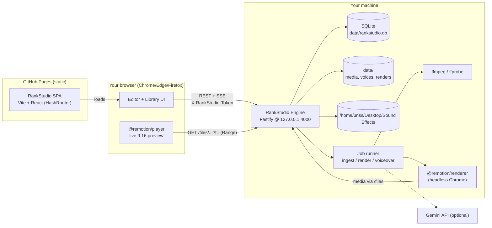
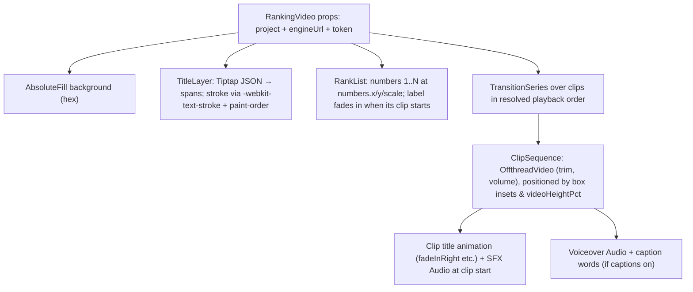
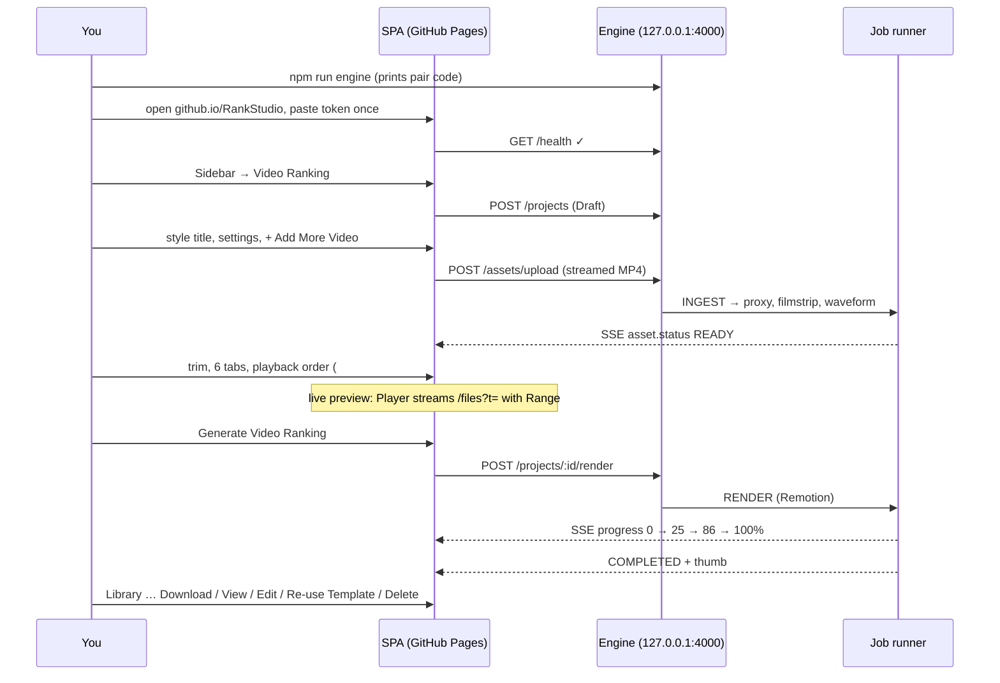

# RankStudio — Implementation Plan v3 (GitHub Pages Frontend + Local Engine)

> [!NOTE]
> **Planning only.** No code has been written. You will implement this plan yourself. The phases are ordered so that each milestone runs on its own.

## Goal

Build **RankStudio**: a single-user app with a dark theme for making 9:16 **Video Ranking** videos, modelled on Viblo.

- The **frontend** is a static site hosted on **GitHub Pages** (`https://<your-user>.github.io/RankStudio/`).
- The heavy work runs on **your machine** in a small background server called the **RankStudio Engine** (`http://127.0.0.1:4000`). It handles file storage, ffmpeg and Remotion rendering.
- Live preview and final render share **one Remotion composition**, so what you see is what you download.

### Final decisions
| Topic | Decision |
|---|---|
| Frontend hosting | **GitHub Pages** (static SPA, deployed by GitHub Actions) |
| Backend | **Local engine** on `127.0.0.1:4000` (Node + Fastify), run by you |
| Render engine | Remotion (individual free license) |
| Scope | Video Ranking + Library + sidebar shell; the other 7 tools are "Coming soon" |
| Users | Single user, no accounts. Access is protected by a **pairing token**. |
| Media import | **Local upload only** (MP4/MOV/WebM ≤ 500 MB) |
| Sound effects | `/home/unss/Desktop/Sound Effects` (checked: **21 `.mp3` files, flat folder, 1.8 MB**), plus in-app upload |
| Fonts | You have none, so a **bundled offline set** (`@fontsource/*`); **"Ranking Font" = Anton** as a stand-in |
| Voiceover | Manual script + **upload your own voice audio** (default); Gemini AI script/TTS **optional**, hidden without a key |
| Captions | Built from the voiceover script, timed across the voice audio (no AI needed) |
| Theme / name | Dark, "RankStudio" |

---

## User Review Required

> [!IMPORTANT]
> **GitHub Pages can only host static files.** It cannot store your 500 MB clips, run ffmpeg or render MP4s. So the app is split into two parts:
> 1. **Frontend** (GitHub Pages): all the UI, the editor and the live preview.
> 2. **Engine** (your PC, `npm run engine`): projects DB, uploaded clips, SFX, rendering, Library progress.
>
> When you open the GitHub Pages site, it connects to `http://127.0.0.1:4000`. If the engine isn't running, the app shows a **"Start your engine"** screen with the exact command. Your media **never leaves your machine**.

> [!WARNING]
> **Browser requirements.** Chrome, Edge and Firefox allow an `https://` page to talk to `http://127.0.0.1` because localhost counts as a secure origin. **Chrome 142+ asks once to "allow access to your local network"** — click Allow. **Safari blocks this.** Use Chrome, Edge or Firefox.

> [!IMPORTANT]
> **Security.** Other websites in your browser could also try to call `127.0.0.1:4000`. To prevent that, the engine:
> - listens **only on 127.0.0.1**,
> - only accepts requests from an **allowlist of origins** (CORS: your `github.io` URL + `http://localhost:5173` for development),
> - requires a **pairing token** on every request (`X-RankStudio-Token` header, or `?t=` on media URLs). The token is generated on first start, printed in the terminal and pasted once into the app's Settings.

> [!TIP]
> **Offline bonus:** the engine can also serve the built frontend at `http://127.0.0.1:4000/`, so RankStudio still works with no internet and no GitHub. It's the same build, just a different origin.

## Open Questions

> [!IMPORTANT]
> 1. **GitHub username and repo name.** The plan assumes the repo is `RankStudio`, so Vite `base: "/RankStudio/"`. If you use a different repo name, change `base` and the CORS allowlist (`ALLOWED_ORIGINS`).
> 2. **Alternative architecture (not recommended for v1):** a **100% in-browser** version with no engine. It would store data in IndexedDB/OPFS, read the SFX folder via the File System Access API and render via Remotion's experimental web renderer (WebCodecs). It needs nothing installed, but it's Chrome-only, renders slowly, has limited CSS support (text stroke and some animations won't match), and big files stretch browser storage. **This plan uses the engine.** Tell me if you'd rather have the in-browser version.

---

## Architecture



### Repository layout (npm workspaces)

```
RankStudio/
├─ apps/
│  ├─ web/            # Vite + React SPA  → GitHub Pages
│  └─ engine/         # Fastify server + job runner → runs locally
├─ packages/
│  ├─ composition/    # Remotion <RankingVideo> + zod schema (shared by web & engine)
│  └─ shared/         # API types, route contracts, constants
├─ .github/workflows/deploy-pages.yml
├─ package.json  tsconfig.base.json  .env.example  README.md
└─ data/              # (gitignored) created by engine at first start
```

### Tech stack

| Concern | Choice | Why |
|---|---|---|
| Frontend | **Vite + React 19 + TypeScript** | Static output that suits GitHub Pages (Next.js static export can't handle dynamic routes well) |
| Routing | **React Router (HashRouter)** e.g. `/#/video-ranking/:id`, `/#/library?filter=video-ranking` | Deep links work on GitHub Pages without 404 hacks |
| UI | Tailwind v4 + shadcn/ui (dark) + lucide-react | |
| State | Zustand + `zundo` (undo/redo) + debounced autosave | |
| Server state | TanStack Query | caching, polling, retries |
| Rich-text title | Tiptap (TextStyle, Color, Highlight, FontFamily, custom FontSize, Bold, Italic, TextAlign, History) | partial-word styling |
| Emoji | `emoji-mart` (data bundled) | works offline |
| Colours | `react-colorful` + palette + recent/custom colours (localStorage) | |
| Sortable lists | `@dnd-kit/sortable` | playback order + rank reorder |
| On-canvas drag | `react-moveable` overlay on the Player | Drag Title / Number / Video |
| Video | Remotion 4: `@remotion/player` (web), `@remotion/bundler` + `@remotion/renderer` (engine), `@remotion/transitions` | |
| Fonts | `@fontsource/*` | offline, same fonts in preview and render |
| Engine HTTP | Fastify + `@fastify/cors` + `@fastify/multipart` (streaming) | |
| DB | SQLite via **better-sqlite3 + Drizzle ORM** | zero-ops, synchronous, no native server |
| Media | ffmpeg 6.1 / ffprobe (already installed) | |
| Optional AI | `@google/genai` (Gemini text + Gemini TTS) | |
| Tests | Vitest, Playwright, Remotion `renderStill` snapshots | |

> [!NOTE]
> Your Node is **v22.5.1**, which is fine. Use **npm** (your pnpm needs Node ≥ 22.13).

---

## Configuration

#### [NEW] `.env.example` (engine)
```dotenv
ENGINE_HOST=127.0.0.1
ENGINE_PORT=4000
DATA_DIR=./data
SFX_DIR="/home/unss/Desktop/Sound Effects"     # quoted: path contains a space
ALLOWED_ORIGINS=https://<your-user>.github.io,http://localhost:5173,http://127.0.0.1:4000
MAX_UPLOAD_MB=500
RENDER_CONCURRENCY=1
GEMINI_API_KEY=                                  # optional; enables AI voiceover
```

#### [NEW] `apps/web/.env.example`
```dotenv
VITE_DEFAULT_ENGINE_URL=http://127.0.0.1:4000
```
You can change the engine URL and token in the app's **Settings** dialog (saved in localStorage).

---

## Data Model

### Project document — `packages/composition/src/schema.ts`
```ts
export const TextStyle = z.object({
  fontFamily: z.string().default("Archivo Black"),
  fontSize: z.number().default(28),
  bold: z.boolean().default(false),
  italic: z.boolean().default(false),
  color: z.string().default("#FFFFFF"),
  highlight: z.string().nullable().default(null),
  strokeColor: z.string().default("#000000"),
  strokeWidth: z.number().min(0).max(20).default(0),
});

export const Clip = z.object({
  id: z.string(),
  rank: z.number(),                                     // display number 1..N
  media: z.object({ assetId: z.string().nullable(), durationSec: z.number().nullable(),
                    width: z.number().nullable(), height: z.number().nullable() }),
  trim: z.object({ startSec: z.number(), endSec: z.number() }),
  volume: z.number().min(0).max(1).default(1),
  title: z.object({ text: z.string(), style: TextStyle }),
  number: z.object({ color: z.string(), fontFamily: z.string(), bold: z.boolean(),
                     strokeColor: z.string(), strokeWidth: z.number() }),
  box: z.object({ top: z.number(), right: z.number(), bottom: z.number(), left: z.number() }), // % insets
  voiceover: z.object({
    enabled: z.boolean(),
    mode: z.enum(["manual", "upload", "ai"]),           // ai only if engine reports Gemini available
    script: z.string(),
    ai: z.object({ topic: z.string(), tone: z.string(), length: z.enum(["short","medium","long"]),
                   hook: z.string(), cta: z.string() }),
    voiceId: z.string().nullable(),                     // Gemini prebuilt voice
    audioAssetId: z.string().nullable(),                // uploaded or generated audio
  }),
  animation: z.object({
    text: z.object({ type: z.enum(["none","fadeIn","fadeInRight","fadeInLeft","fadeInUp",
                                   "fadeInDown","zoomIn","bounceIn","typewriter"]),
                     durationSec: z.number(), delaySec: z.number() }),
    transition: z.enum(["none","fade","slide","wipe","flip","clockWipe"]),
  }),
  sfx: z.object({ id: z.string().nullable(), volume: z.number().min(0).max(1) }),
});

export const RankingProject = z.object({
  version: z.literal(1),
  title: z.object({
    doc: z.any(),                                       // Tiptap JSON (per-word styles)
    align: z.enum(["left","center","right"]),
    position: z.object({ x: z.number(), y: z.number() }),
    strokeColor: z.string(), strokeWidth: z.number(),
  }),
  general: z.object({ videoHeightPct: z.number().min(30).max(100).default(80),
                      background: z.string().default("#2B2A2A"), captions: z.boolean().default(false) }),
  playback: z.object({ custom: z.boolean(), mode: z.enum(["manual","shuffle"]),
                       order: z.array(z.string()), seed: z.number() }),
  numbers: z.object({ dragEnabled: z.boolean(), x: z.number(), y: z.number(), scale: z.number() }),
  clips: z.array(Clip).min(1),
});
export type RankingProject = z.infer<typeof RankingProject>;
```

### SQLite tables — `apps/engine/src/db/schema.ts` (Drizzle)
```ts
export const projects = sqliteTable("projects", {
  id: text("id").primaryKey(),
  tool: text("tool").notNull().default("video-ranking"),
  name: text("name").notNull(),
  data: text("data", { mode: "json" }).notNull(),     // RankingProject
  status: text("status").notNull().default("DRAFT"),  // DRAFT|RENDERING|COMPLETED|FAILED
  progress: real("progress").notNull().default(0),
  outputPath: text("output_path"), thumbPath: text("thumb_path"), error: text("error"),
  createdAt: integer("created_at", { mode: "timestamp_ms" }).notNull(),
  updatedAt: integer("updated_at", { mode: "timestamp_ms" }).notNull(),
});

export const assets = sqliteTable("assets", {
  id: text("id").primaryKey(),
  kind: text("kind").notNull(),          // VIDEO | VOICE | SFX_UPLOAD
  path: text("path").notNull(),          // relative to DATA_DIR
  origName: text("orig_name").notNull(),
  durationSec: real("duration_sec"), width: integer("width"), height: integer("height"),
  filmstrip: text("filmstrip"), waveform: text("waveform"),
  status: text("status").notNull().default("PENDING"),  // PENDING|READY|FAILED
  error: text("error"),
  createdAt: integer("created_at", { mode: "timestamp_ms" }).notNull(),
});

export const jobs = sqliteTable("jobs", {
  id: text("id").primaryKey(),
  type: text("type").notNull(),          // INGEST | RENDER | VOICEOVER
  payload: text("payload", { mode: "json" }).notNull(),
  status: text("status").notNull().default("QUEUED"),   // QUEUED|RUNNING|DONE|FAILED
  attempts: integer("attempts").notNull().default(0),
  error: text("error"),
  createdAt: integer("created_at", { mode: "timestamp_ms" }).notNull(),
  updatedAt: integer("updated_at", { mode: "timestamp_ms" }).notNull(),
});
```

### Disk layout (engine)
```
data/
  rankstudio.db
  token.txt                         # pairing token (generated at first start)
  media/<assetId>/source.ext, proxy.mp4, filmstrip.jpg, waveform.json
  voices/<assetId>.(wav|mp3)
  sfx-uploads/<id>.mp3
  renders/<projectId>/output.mp4, thumb.jpg
```

### SFX index
The engine scans `SFX_DIR` (and `data/sfx-uploads`) for `.mp3/.wav/.ogg/.m4a`. It runs ffprobe for the duration and caches the results by file mtime. Your folder is flat, so every effect goes in the single category "My Sounds". Display names are cleaned up:

| File | Displayed as |
|---|---|
| `suspicious_kPZ01VF.mp3` | Suspicious |
| `metal-gear-alert-sound-effect_XKoHReZ.mp3` | Metal Gear Alert Sound Effect |
| `Huh - QuickSounds.com.mp3` | Huh |

The rules: strip the extension, a trailing `_XXXXXXX` random suffix and ` - QuickSounds.com`, replace `-`/`_` with spaces, then title-case. The SFX `id` is a stable hash of the relative path.

---

## Engine API Contract (`packages/shared/src/api.ts`)

All requests must include `X-RankStudio-Token`, except `GET /health`. Media URLs use `?t=<token>` because `<video>` elements can't send headers.

| Method & path | Purpose |
|---|---|
| `GET /health` | `{ ok, version, gemini: boolean, sfxDir, paired: boolean }` (paired = token valid) |
| `GET /projects?tool=video-ranking` | list for Library and Recently Created |
| `POST /projects` | create a draft from `defaultProject()` |
| `GET/PATCH/DELETE /projects/:id` | load / autosave (`data`, `name`) / delete (and its files) |
| `POST /projects/:id/duplicate?template=1` | Re-use Template (clears clip media, trim and voice audio) |
| `POST /projects/:id/render` | checks every clip has READY media and a valid trim, then sets RENDERING and queues a RENDER job |
| `POST /projects/:id/render/cancel` | cancels via Remotion `cancelSignal` |
| `GET /events` (SSE) | `project.progress`, `project.status`, `asset.status` events |
| `POST /assets/upload` (multipart, streamed) | `kind=VIDEO|VOICE|SFX_UPLOAD` → returns the asset, queues INGEST |
| `GET /assets/:id` | status + metadata (filmstrip, waveform URLs) |
| `GET /assets?kind=VOICE` | Library "Voices" tab |
| `GET /sfx?q=` | searchable SFX list `{ id, name, category, durationSec, url }` |
| `GET /files/*?t=` | streams files from `DATA_DIR` / `SFX_DIR` with **HTTP Range**; resolves real paths and rejects anything outside those roots |
| `GET /renders/:projectId/download?t=` | `Content-Disposition: attachment` MP4 |
| `POST /ai/script` *(Gemini only)* | returns a generated script for review |
| `POST /ai/voice` *(Gemini only)* | queues a VOICEOVER job (script → TTS → VOICE asset) |

---

## Composition Design (`<RankingVideo>` — 1080×1920 @ 30 fps)



- **`resolveOrder(project)`:**
  - Custom off → countdown N → 1.
  - Manual → `playback.order`.
  - Shuffle → seeded Fisher–Yates using `playback.seed`, so preview and render get the same order.
  - **Sync All** = reset the order to N → 1.
  - Status pill: "All N clips in order", or "2 clips missing from order".
- **`computeDuration(project)`:** Σ(end − start) minus transition overlaps (0.5 s each). Used by the Player's `durationInFrames` and the renderer's `calculateMetadata`.
- **Clip length:** at least 0.5 s. A clip with a voiceover longer than the trimmed video is held on its last frame until the voice ends (`max(trim, voice)`).
- **Captions:** the script is split into words and spread evenly across the voice duration, three words per caption chunk. Styled by the global caption style (white, black stroke).
- **Media URLs:** `${engineUrl}/files/${path}?t=${token}`, the same in preview and render.

---

## Proposed Changes (greenfield — every file is NEW)

### Phase 0 — Repo scaffold
#### [NEW] `package.json`
```json
{
  "name": "rankstudio",
  "private": true,
  "workspaces": ["apps/*", "packages/*"],
  "scripts": {
    "dev": "concurrently -n web,engine \"npm -w apps/web run dev\" \"npm -w apps/engine run dev\"",
    "engine": "npm -w apps/engine run start",
    "build": "npm -w packages/composition run build && npm -w apps/web run build && npm -w apps/engine run build",
    "test": "vitest run",
    "test:render": "npm -w apps/engine run test:render",
    "e2e": "playwright test",
    "typecheck": "tsc -b",
    "lint": "eslint ."
  }
}
```
#### [NEW] `tsconfig.base.json`, `.gitignore` (`data/`, `node_modules`, `dist`, `.env`), `README.md` (setup, pairing, browser notes), `.env.example`

### Phase 1 — Shared packages
#### [NEW] `packages/shared/src/{api.ts,constants.ts}` — route paths, request/response types, `ENGINE_DEFAULT_URL`, upload limits
#### [NEW] `packages/composition/src/schema.ts` — schema, `defaultProject()`, `defaultClip(rank)`, `migrate()`
#### [NEW] `packages/composition/src/logic/{order.ts,duration.ts,tiptapToSpans.ts,captions.ts}`
#### [NEW] `packages/composition/src/RankingVideo.tsx`, `layers/{TitleLayer,RankList,ClipSequence,Captions}.tsx`, `animations.ts`, `transitions.ts`
#### [NEW] `packages/composition/src/fonts.ts` — fontsource imports + `FONT_LIST`:
Archivo Black, ABeeZee, Abril Fatface, Anton (**"Ranking Font"** alias), Bebas Neue, Bangers, Montserrat, Poppins, Oswald, Roboto, Inter, Lobster, Pacifico, Permanent Marker, Russo One, Righteous, Bungee, Black Ops One, Luckiest Guy, Fredoka, Rubik, Playfair Display, Teko, Barlow Condensed, Kanit.
#### [NEW] `packages/composition/src/Root.tsx` — `registerRoot`, `<Composition id="RankingVideo" calculateMetadata=…>`

### Phase 2 — Engine core (`apps/engine`)
#### [NEW] `src/config.ts` — loads `.env` with zod validation; resolves `SFX_DIR`
#### [NEW] `src/server.ts` — Fastify on `ENGINE_HOST:ENGINE_PORT`; CORS allowlist; adds the `Access-Control-Allow-Private-Network: true` header to preflights (for Chrome); token hook; optionally serves `apps/web/dist` at `/`
#### [NEW] `src/auth.ts` — generates `data/token.txt` (32 random bytes, base64url) on first start and prints `Pair code: …` + a one-click link `https://<user>.github.io/RankStudio/#/settings?token=…`
#### [NEW] `src/db/{schema.ts,client.ts,migrate.ts}` — Drizzle + better-sqlite3, WAL mode
#### [NEW] `src/routes/{health,projects,assets,sfx,files,renders,events,ai}.ts`
#### [NEW] `src/lib/{paths.ts (safeResolve), range.ts, sse.ts, ffprobe.ts, sfxIndex.ts, prettifyName.ts}`

### Phase 3 — Job runner
#### [NEW] `src/jobs/runner.ts` — in-process loop (every 500 ms): claims QUEUED jobs atomically (`UPDATE … WHERE status='QUEUED' RETURNING`); concurrency 1 render + 2 ingests; on boot, marks RUNNING jobs FAILED as "interrupted"; sends SSE events
#### [NEW] `src/jobs/ingest.ts`
- ffprobe the file.
- If it isn't browser-safe (H.264 + AAC, yuv420p), transcode it: `ffmpeg -i source -c:v libx264 -preset veryfast -crf 20 -pix_fmt yuv420p -c:a aac -movflags +faststart proxy.mp4`
- Build a filmstrip sprite: `fps=1,scale=-1:90,tile=Nx1`
- Build the waveform: `-ac 1 -ar 8000 -f s16le` → 400 peaks in JSON
- Mark the asset READY.
#### [NEW] `src/jobs/render.ts`
- `bundle({ entryPoint: composition/Root.tsx })` once at startup, cached in memory.
- `selectComposition`, then `renderMedia({ codec: "h264", inputProps, onProgress, cancelSignal })`.
- Progress is written to the DB and SSE at most every 500 ms.
- `renderStill` at 1 s → `thumb.jpg`, then COMPLETED. On error: FAILED + error message.
#### [NEW] `src/jobs/voiceover.ts` *(optional)* — Gemini text model generates the script from Topic/Tone/Length/Hook/CTA → Gemini TTS (prebuilt voice) → PCM → WAV → VOICE asset

### Phase 4 — Frontend shell (`apps/web`)
#### [NEW] `vite.config.ts` — `base: "/RankStudio/"`, React plugin, workspace aliases
#### [NEW] `src/main.tsx`, `src/App.tsx` — `HashRouter` routes:
`/` Home · `/library` · `/tutorial` · `/free-course` · `/video-ranking-new` · `/video-ranking/:id` · `/tools/:slug` (Coming soon) · `/settings`
#### [NEW] `src/styles/globals.css` — dark tokens (bg `#0E0E10`, panel `#17171B`, accent violet `#7C5CFF`)
#### [NEW] `src/components/{Sidebar.tsx, EngineGate.tsx, SettingsDialog.tsx}`
- **Sidebar:** collapsible (state in localStorage); Core and Tools sections.
- **EngineGate:** polls `/health`. It shows one of three screens: **Engine offline** (with the `npm run engine` instructions), **Not paired** (paste token), or **Connected**.
#### [NEW] `src/lib/{engine.ts (fetch wrapper adds token), events.ts (SSE via EventSource with ?t=), fileUrl.ts}`

### Phase 5 — Editor layout & store
#### [NEW] `src/features/ranking/store.ts` — Zustand + zundo; `PATCH /projects/:id` debounced 800 ms; "Saving… / Saved" indicator
#### [NEW] `src/features/ranking/{EditorPage,EditorLayout,PreviewPanel,RecentlyCreated,EditorActions}.tsx`
- **PreviewPanel:** sticky 9:16 Player with play/pause, scrub, volume, fullscreen and a `?` help popover.
- **EditorActions:** **Save as Draft**, **Generate Video Ranking**.

### Phase 6 — Title editor & canvas drag
#### [NEW] `src/features/ranking/title/{TitleEditor,TitleToolbar,FontPicker,FontSizeSelect,ColorPopover,EmojiPopover,TitleStroke}.tsx`
#### [NEW] `src/features/ranking/canvas/CanvasOverlay.tsx` — `react-moveable` for Drag Title, Number Drag & Resize and per-clip Drag Video (converts px ↔ %)

### Phase 7 — Settings & playback
#### [NEW] `src/features/ranking/settings/{GeneralSettings,PlaybackOrder,NumberDrag}.tsx`

### Phase 8 — Rank slots
#### [NEW] `src/features/ranking/clips/{ClipAccordion,UploadDropzone,ClipTrimmer}.tsx`
- **ClipAccordion:** expand, delete, move up/down, **+ Add More Video**.
- **UploadDropzone:** XHR upload with a progress bar (500 MB limit checked in the browser); Re-upload; shows the ingest state.
- **ClipTrimmer:** filmstrip + waveform, green Start and red End handles, arrow-key nudge (0.1 s), volume.
#### [NEW] `src/features/ranking/clips/tabs/{VideoTitleTab,NumberAppearanceTab,SizePositionTab,VoiceoverTab,AnimationTab,SoundEffectTab}.tsx`
- **VoiceoverTab:** Manual script, **Upload voice audio**, or AI (only shown when `health.gemini`).
- **SoundEffectTab:** search your 21 sounds, ▶ inline preview, Upload Sound Effect, Effect Volume.

### Phase 9 — Library
#### [NEW] `src/features/library/{LibraryPage,ProjectCard,ProjectMenu,ViewModal}.tsx`
- **Tabs:** Videos (projects), Image (render thumbnails), Voices (VOICE assets). Tool filter dropdown → `?filter=video-ranking`.
- **Card states:** Draft · Rendering… with live % bar (SSE) · Completed with thumbnail and ▶ · Failed with retry.
- **`…` menu:** Download, Edit, View, Re-use Template, Delete (with confirm).

### Phase 10 — Deployment & polish
#### [NEW] `.github/workflows/deploy-pages.yml`
```yaml
name: Deploy frontend to GitHub Pages
on: { push: { branches: [main] }, workflow_dispatch: {} }
permissions: { contents: read, pages: write, id-token: write }
concurrency: { group: pages, cancel-in-progress: true }
jobs:
  build:
    runs-on: ubuntu-latest
    steps:
      - uses: actions/checkout@v4
      - uses: actions/setup-node@v4
        with: { node-version: 22, cache: npm }
      - run: npm ci
      - run: npm -w packages/composition run build && npm -w apps/web run build
      - run: cp apps/web/dist/index.html apps/web/dist/404.html
      - uses: actions/upload-pages-artifact@v3
        with: { path: apps/web/dist }
  deploy:
    needs: build
    runs-on: ubuntu-latest
    environment: { name: github-pages, url: "${{ steps.d.outputs.page_url }}" }
    steps:
      - id: d
        uses: actions/deploy-pages@v4
```
In the repo, go to Settings → Pages → Source: **GitHub Actions**.

#### Polish
Empty states, toasts, unsaved-change guard, shortcuts (Space play/pause, Ctrl+Z / Ctrl+Shift+Z), editor minimum width of 1024 px (mobile warning), Tutorial page content.

---

## End-to-End Flow



---

## Verification Plan

### Automated Tests
```bash
npm run typecheck && npm run lint
npm run test         # Vitest:
                     #  composition: resolveOrder (countdown/manual/shuffle-seeded/sync), computeDuration
                     #    with transitions + voice hold, tiptapToSpans, captions chunking, schema defaults/migrate
                     #  engine: safeResolve rejects ../ and symlink escapes; Range 206 responses;
                     #    token hook (401 without token); CORS rejects unknown origin;
                     #    prettifyName on your real SFX filenames; job claim atomicity
npm run test:render  # renderStill golden PNGs at frames 0, mid-clip, transition, end
npm run e2e          # Playwright (engine + vite dev): pair → new project → styled title →
                     #  upload 4 fixture MP4s → trim → countdown order → pick "Suspicious" SFX →
                     #  Generate → Library shows % → Completed → download returns valid MP4
```
**Engine integration test:** render a 3-clip fixture, then use `ffprobe` to check the output is 1080×1920 H.264 + AAC at 30 fps, with duration within ±0.2 s of `computeDuration`.

### Manual Verification
1. `cp .env.example .env` (check that `SFX_DIR` and `ALLOWED_ORIGINS` contain your github.io URL) → `npm install` → `npm run engine` → copy the pair code.
2. **Local dev:** `npm run dev` → http://localhost:5173/RankStudio/ → paste the token.
3. **GitHub Pages:** push to `main` → wait for the Actions run → open `https://<user>.github.io/RankStudio/` in Chrome → click **Allow** on the local-network prompt → paste the token (or use the one-click link from the terminal).
4. Stop the engine and check that the **Engine offline** screen appears. Start it again and check the app reconnects by itself.
5. Run the full workflow from the spec: give one word in the title its own colour and font, drag the title, set 80% height and `#2B2A2A`, upload 4 clips, trim them, set a countdown order, add SFX from your folder and a manually uploaded voice, then Generate → watch the progress → Download and compare with the preview.
6. Re-use Template → a new draft with the same styling and empty clips. Delete → the card disappears and `data/renders/<id>` is removed.

### Milestones (implement in order)
| # | Phases | Done when |
|---|---|---|
| M1 | 0–2, 4 | The engine runs; the SPA (local + Pages) connects and pairs; the sidebar shell works |
| M2 | 1, 5–7 | The editor shows a live preview of default data; title styling, dragging, settings and playback order work |
| M3 | 3 (ingest), 8 | Upload → ingest → trim → all 6 tabs, with SFX from your folder and voice upload |
| M4 | 3 (render), 9 | Generate → live Library progress → Completed → Download, View, Edit, Re-use, Delete |
| M5 | 10 (+ optional Gemini) | Pages deploy workflow, polish, AI voiceover if you add a key |
